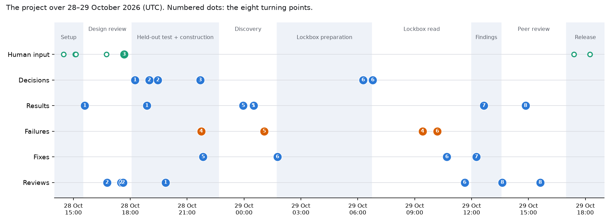

# How we got here: the research journey

**The main point.** The final method looks the way it does because the project spent most of its effort making sure it could not fool itself, and then most of its findings shrank under that scrutiny. The one clear success, the pair score beating its baselines on held-out hu.MAP pairs, came mainly from large, pair-rich complexes, and every test of whether that success carries over to better complexes or more replicable cancer dependencies came back null or negative. The pipeline's distinctive parts (a held-out set of cell lines read once, a machine-readable registry of every analysis, matched-set and never-expressed calibrations, and a fixed rule for picking the strongest findings) were added by design reviewers before any result existed, or forced in by gaps and failures afterwards. The claims narrowed at each step, ending as "replicated, robustness-checked module-level associations", not "complex-specific dependencies".

**Who is who.** "The PI" in the project records is the main AI agent, which was told to act as principal investigator. It ran 55 subagents (coders, reviewers, writers, verifiers, one peer reviewer). "The user" is the human who wrote the brief (`PROMPT.md`) and supplied data. All times are UTC, from git commit timestamps unless marked as transcript times.

**Terms used throughout.**
- *zavg_BEF* is the locked pair score from Part 1: the equal-weight mean of three z-scored similarity components computed on DepMap CRISPR gene-effect profiles. It is unsupervised, but its configuration was chosen on hu.MAP training complexes.
- *GLS* is the generalised-least-squares co-essentiality score of Wainberg et al. (2021), the standard baseline.
- *DepMap* is the Cancer Dependency Map: CRISPR knockout screens in about 1,350 cancer cell lines. A gene's *effect* (Chronos score) is negative when knocking it out slows growth; about −1 is a typical essential gene.
- *hu.MAP 3.0* is a curated atlas of human protein complexes. Its test split had been withheld from Part 1.
- *BioPlex 3.0* is a large affinity-purification mass-spectrometry map of physical protein interactions.
- *AP* (average precision) summarises a precision–recall curve; it was the primary metric.

## Timeline overview

| When (UTC) | Phase | What happened |
|---|---|---|
| 28 Oct 14:28–15:08 | Setup | Brief received; literature review, Part 1 leakage audit, data profile; user asked for data |
| 15:36–17:38 | Design review | Three rounds, 6 + 5 + 1 reviewer agents; DESIGN v1 → v3.1 |
| 18:14–19:51 | Held-out test | Protocol frozen, single look, independent reproduction |
| 18:55–22:24 | Construction | Lockbox drawn, registry drafted, complex maps frozen; BioPlex bridge null |
| 22:52–01:46 | Discovery | Contexts frozen, controls, five discovery runs, late calibrations |
| 29 Oct 01:45–06:41 | Lockbox preparation | Missing code found, amendments, 2.7 h dress rehearsal |
| 06:47–11:38 | Lockbox read | Single 2.6 h read; covariate defect; corrected relook; review |
| 12:05–13:29 | Findings and manuscript | Robustness computed late; 254 strongest findings; manuscript condensed |
| 13:37–16:23 | Peer review | Major revision, post hoc analyses, minor revision, final REPORT |
| 17:23–18:21 | Release | Public GitHub push; local paths scrubbed |

<!-- widget:timeline -->

*Each dot is an event from `data/journey.json` (git commit times and the session transcript). Numbered dots belong to the eight turning points below. Green: human input; orange: failures; blue: everything else.*

The science ran for about 26 hours (14:28 on 28 Oct to 16:37 on 29 Oct). The repository has 335 commits.

## 1. A frozen, rehearsed single look at the test pairs

**Situation.** The hu.MAP test files arrived at 13:55, 59.6 minutes after the final Part 1 commit, as plain files, and Part 1's scores already covered every test pair. Nothing technical stopped a peek; indeed the leakage-audit agent counted test pairs in Part 1's top-pair table (equivalent to precision and recall at one threshold), which was deleted unseen and disclosed. How do you make one honest look?

**Options.** The design reviewers proposed having the user hold the test files in escrow. The alternative was a procedural guarantee: freeze the protocol and code, commit a "started" record before reading labels, and allow one look.

**Evidence.** The protocol agent first built the evaluation harness and ran it on Part 1's own internal final test. It reproduced those numbers to within 1.5 × 10⁻⁸ (commit `7a842f2`, 15:36), so the harness was known to be correct before it touched new labels. Two review rounds then tightened the protocol (v1.0 → v1.2): a freeze marker hashing the protocol, rules, code, packages and test files; a reflog scan for prior looks; and the rule that the verdict is computed on S1, the pairs every method can score, with all pairs (intention-to-score, ITT) quoted alongside. Freeze `039a843` came at 18:14, the started record `7afcf06` at 18:18, and results `0861e59` at 18:52.

The result, on the intention-to-treat set (all 600,738 test pairs, unmapped ones scored at the floor): AP 0.333 [95% CI 0.256, 0.410] for zavg_BEF, against 0.212 for GLS, 0.204 for Spearman and 0.197 for Pearson. The difference from GLS was +0.121 [+0.079, +0.159]. A verifier that had not written the harness committed its own numbers first (`c69d828`), then compared them (`8d009f2`): every verdict number matched to 2.6 × 10⁻¹⁵.

The average hid where the gain came from. Macro AP, averaged per test cluster, was 0.297 against 0.292 for GLS. A descriptive export (`ddd6e83`) gave the difference from GLS by positive pairs per cluster: −0.033 (1 pair), −0.024 (2–5), +0.041 (6–20), +0.126 (21–100), +0.142 (101+). The effective number of clusters was 21.3.

**Outcome.** The method's input is validated, but narrowly: it ranks pairs inside large complexes better. This was the first hint that the pair-level win might not survive at the level of complexes (turning point 4). The freeze → intent → started record → single look pattern became the template for the lockbox read.

Shaped: [Step 0](METHOD.md#step0), [Step 6](METHOD.md#step6)

**References.** `docs/TEST_PROTOCOL.md`, `docs/TEST_PROTOCOL.FROZEN`; `results/test_eval/test_results.json`; `results/test_eval/export/`; RESEARCH_TREE.md decision notes D0, D1, D3; commits `7a842f2`, `039a843`, `7afcf06`, `0861e59`, `c69d828`, `8d009f2`, `ddd6e83`.

## 2. Reviewers replace split-half replication with a lockbox, a registry and bridges

**Situation.** DESIGN v1 (`d6bf744`, 15:08) planned to tune the downstream pipeline on the split-half replication rate of context associations: split the cell lines in half, discover on one half and replicate on the other, over 10 split seeds. The same lines would then supply the final claims. The brief required up to three review rounds by agent reviewers covering prior work, statistics, data, algorithms and compute, AI-agent failure modes, and an external PI.

**Options.** Keep split-half replication and add corrections, or hold out a block of cell lines that nothing touches until a single confirmatory read.

**Evidence.** The AI-failure reviewer called the v1 plan "selection on the outcome": dozens of pipeline variants would be ranked on the same lines that supply the claims. Its MUST-7 asked for a 25% lockbox of cell lines, MUST-8 for an analysis registry with a trial ledger and a pre-written strongest-findings rule. The external-PI reviewer showed split-half replication has about 0.2 power for rare contexts, and asked for a "bridge": run the same pipeline on GLS scores and test whether the better pair score gives better complexes. The statistics reviewer brought HC3 standard errors and Freedman–Lane permutation; round 2 added Benjamini–Bogomolov FDR, a concrete bridge endpoint (BioPlex precision at matched coverage), driver/genome-state contexts and an equivalence margin for the within-complex panel (`5d9ead1`). Round 3 (`bdb8816`, 17:37) fixed the bridge CI, the lockbox strata and the read order.

**Outcome.** The lockbox L (338 lines, 25.1%) and construction set A (1,007 lines) were drawn at 19:00 (`4f6ecab`). The split blocks by PatientID, so no patient's lines straddle A and L, and it is stratified on lineage and 18 genotype labels only, never on dependency values. Twenty-nine registry entries followed at 19:27 (`ee45596`): 23 control entries, four directions, and the two downstream benchmarks. The four directions are a lineage atlas, driver/genome-state contexts, a within-complex loss panel, and sub-module divergence. The benchmarks are BENCH (does a complex score replicate better than its best single gene?) and BRIDGE-L (do discoveries on the zavg map confirm in L more often than discoveries on the GLS map?). The engine refuses unregistered analyses and logs every run. A *kill rule* drops any direction that recovers fewer than half its evaluable positive controls. The whole design phase took about 2 hours.

Shaped: [Step 1](METHOD.md#step1), [Step 4](METHOD.md#step4), [Step 6](METHOD.md#step6)

**References.** `docs/reviews/round1_ai_failure.md` (MUST-7, MUST-8), `round1_pi.md` (M2), `round1_response.md`, `round2_pi.md`, `round3_final.md`; DESIGN.md history header and §9; commits `d6bf744`, `061bd1d`, `5d9ead1`, `bdb8816`, `4f6ecab`, `ee45596`.

## 3. A graph built for dependency-bearing genes, tuned without labels

**Situation.** Turning pair scores into complexes needs a graph and a clustering. The brief forbids curated complexes, and the data profile (M1) found a problem: the graph at z ≥ 5 had 163,000 edges, with hubs of never-essential genes. Choosing parameters by agreement with CORUM or hu.MAP, as earlier studies did (Chen 2023 tuned on CORUM, Kim 2019 on GO), was ruled out as circular.

**Options.** DESIGN v1 proposed a variance filter on genes and picking parameters by maximising clustering stability. The algorithms reviewer tested both.

**Evidence.** The variance filter "removes almost nothing". Among edges between two never-essential genes, 70% (z0 = 5) to 81% (z0 = 6) joined genes on the same chromosome arm, against 3% for random pairs. Of 1,522 clusters, 46% sat mostly on one arm and 76% were mostly never-essential genes. These are copy-number and locus artefacts, not complexes. The stability-maximising rule was degenerate. The reviewer instead proposed:
- a dependency-bearing gene filter (effect < −0.5 in at least 1% of A lines; 6,022 genes);
- mutual top-k edges above a score threshold z0;
- consensus Leiden clustering over 20 PatientID-blocked 80% subsamples × 5 seeds. Leiden is a community-detection algorithm (Traag 2019), run here with the constant Potts model;
- persistence across a resolution grid, in the style of HiDeF;
- a locus flag. It needed gene coordinates, which the user supplied at 17:40 on request.

The rules were fixed on a toy simulation first: 86 of 105 planted complexes were recovered, and pure-null data gave no clusters. Parameters were chosen by a registered split-half recovery statistic that uses no labels. The neighbour count mattered: k = 10 scored 0.338–0.343 against 0.204–0.256 for k = 20. The threshold did not: 0.341, 0.338 and 0.343 for z0 = 4, 5 and 6, with run-to-run SDs of 0.005–0.019. z0 = 6 was picked, the smallest graph.

**Outcome.** The maps were frozen at 21:41 (`27fa9b2`): 367 complexes covering 3,642 genes, median size 9, with 132 sub-modules. 28.3% were locus-flagged and excluded from biological claims. The GLS comparator, built with the same genes, k and edge count, had 379 complexes over 2,862 genes. Map-to-map stability (median best-match Jaccard 0.69 against 0.05–0.08 for random sets) showed the complexes are reproducible. The z0 choice is effectively arbitrary.

Shaped: [Step 2](METHOD.md#step2)

**References.** `results/profile/part2_profile.md`; `docs/reviews/round1_algorithms.md`, `round2_algorithms.md`; `results/part2/construction/selection/selection.json`; `results/part2/construction/README.md`; commits `24e9133`, `f0f940e`, `27fa9b2`, `134a31c`.

## 4. The bridges fail

**Situation.** The pre-registered paper thesis (DESIGN v3.1, top) was that a better pair score yields "a curation-free complex map that agrees better with orthogonal physical evidence than the GLS-module standard". Two bridges tested it. The primary bridge asks whether zavg complexes contain more BioPlex physical-interaction edges than GLS complexes (size-standardised precision, matched coverage, protein-node bootstrap). The secondary bridge, BRIDGE-L, asks whether context discoveries on the zavg map confirm in the lockbox more often than discoveries made with identical machinery on the GLS map.

**Options.** Report each bridge as registered, with the fail paragraph written in advance, or search for a variant that rescues it.

**Evidence.** The BioPlex bridge was computed three minutes after the maps were frozen (`9498d05`, 21:44): −0.025 [−0.075, +0.031], null. Excluding locus clusters gave +0.003, but that explanation is post hoc. Protein co-abundance favoured GLS (−0.061 [−0.101, −0.018]). At the pair level, zavg still ranked BioPlex pairs better (AP 0.0345 against 0.0215 for GLS). BRIDGE-L came out of the lockbox read at 09:24 the next morning. zavg-map discoveries confirmed less often: 0.514 against 0.578, −0.065 [−0.107, −0.025] in the final primary version. The result held at matched coverage (−0.074) and among BioPlex- or proteomics-supported complexes (−0.074), so locus clusters do not explain it. Post hoc, the reviewer-built power model explains 26–41% of the gap; the remaining −0.042 has no tested explanation.

**Outcome.** The thesis was falsified and reported as such. The design had said "Part 2 uses zavg_BEF regardless", so the pipeline was not re-tuned. The zavg map's advantage is restated as coverage (3,642 against 2,862 genes), not better-supported complexes. The manuscript's final title says the score "wins a single held-out test but yields neither better-supported complexes nor more replicable complex-level dependencies".

Shaped: [Step 2](METHOD.md#step2), [Step 6](METHOD.md#step6)

**References.** `results/part2/construction/bridge/bridge.json`; `results/part2/lockbox_confirm/bridge_primary_vs_corrected_R7.json`; `results/part2/revision/README.md` (power analysis R-4); RESEARCH_TREE.md decision notes D5, D12, D19; commits `9498d05`, `71f2206`, `740f439`.

## 5. Late calibrations: the associations are mostly not complex-specific

**Situation.** The registered controls ran once at 23:57 (`4b5f800`); all 15 testable at complex level were recovered (for example, WRN in microsatellite-unstable lines), so the kill rule passed except for sub-module divergence, which had no testable control and became exploratory. Each complex was scored per line as the mean member gene effect, with the context gene, its in-complex paralogs and nearby copy-number genes removed. Discovery ran once per direction on A: 1,145 lineage discoveries from 8,441 tests and 161 driver/genome-state discoveries from 7,340, under Benjamini–Bogomolov selective FDR. Fake contexts reached p < 0.05 at 4.9% and 4.5%, so the tests were calibrated.

**Options.** At 00:39 the discovery agent reported that the registered calibrations had no code: matched random gene sets, never-expressed gene sets, a copy-number segment null and random sub-module splits. The PI could report discoveries without them, or build them now, after discovery but before any lockbox read, and disclose the deviation. The PI chose the second (ruling R4, 00:40).

**Evidence.** The calibrations ran at 01:03–01:06 (`fd582a6`, `4fb83d7`, `1a2a445`).
- Gene sets matched to each complex on size, essentiality and coherence reached p < 0.05 exactly as often as the real complexes: 28.1% against 28.1% in the lineage atlas, and 11.6% against 12.0% for driver contexts.
- Only 502 of 1,145 lineage discoveries beat all of their matched sets.
- Never-expressed gene sets, which should show nothing, reached p < 0.05 at 13.5% against an expected 5%, concentrated in melanoma, skin and lymphoid lines.
- Random sub-module splits produced 78 rejections against 109 real ones.

The PI wrote at 01:17 (transcript): "The calibrations change the story."

**Outcome.** The novelty claim moved from "complex-level context dependencies" to the subset that beats its matched sets, and later shrank again (turning point 8). Peer review showed that the matched sets were drawn from members of other complexes, so "parity" meant parity with other coherent modules. Sets matched on essentiality alone associated less often (16.6% against 28.1%). Calibration became a core step, not an appendix. A related lesson came earlier on synthetic data: a permutation-tail shortcut (fitted tail used far more often than registered, 1,000 instead of 10,000 permutations) gave a pooled false-discovery proportion of 0.086 over 1,000 simulations; it was fixed before any real run (`02f62ee`), and the claim restated as the rate Benjamini–Bogomolov actually controls (0.046).

Shaped: [Step 5](METHOD.md#step5), [Step 4](METHOD.md#step4)

**References.** `results/part2/directions/*/calibration_D8.json`; `results/part2/verify/discovery_review.md`, `h3a_fdr_diagnosis.md`; RESEARCH_TREE.md decision notes D6, D8; commits `4b5f800`, `b0dbd83`, `5e1c1d1`, `44f30ca`, `fd582a6`, `02f62ee`.

## 6. The single lockbox read and the covariate defect

**Situation.** At 01:45 the lockbox agent's dry check stopped before reading anything. Several registered steps had no code: a driver for the rare-context route, lockbox permutation seeds, the BENCH secondary analyses, and the GLS-side discovery for BRIDGE-L. The read could happen only once.

**Options.** Implement exactly as registered, or redefine under-specified steps. For each step, choose between running it and declaring it not run.

**Evidence and decisions.** The rulings, all before the read, were these:
- seeds registered (amendment A3);
- two BENCH secondaries declared NOT RUN, because defining them would add fresh choices and one would widen the read to non-member genes (A4);
- confidence intervals for the BRIDGE-L variants, and literal readings recorded (A5).

A pre-read code review gave GO-WITH-NOTES with three must-fix items. A full dress rehearsal with a dummy lockbox loader then ran for 2.7 hours (`fb54005`, 06:16). The read itself ran 06:50–09:23 (2.6 h). Each entry was persisted with its hash committed, then closed.

Afterwards, 53 fits had failed. The driver had built the lockbox covariate table over all lines and then kept the lockbox rows, so single-line lineages became spurious groups and fits became rank-deficient (26 of 28 failed driver-context fits were whole-genome doubling). The rehearsal had shown the same failures; nobody checked fit status. Ruling R6 labelled the 50 defect failures NOT EVALUABLE and allowed a non-confirmatory refit from the persisted reads, provided the fix first reproduced every successful fit. It did not (`68f0d3f`): 510 successful fits had shifted slightly (median |Δβ| 2.4 × 10⁻⁴, max 0.046), as predicted from labels beforehand. Ruling R7 (`b0ae055`, 10:41) kept the read as executed as primary, with a corrected relook of all 560 affected fits alongside; the 53 calls that differ are "defect-sensitive" and carry no claim.

**Outcome.** Confirmation rates were 0.525 for the lineage atlas and 0.40–0.49 for driver contexts. A results reviewer's post hoc power model expected 0.47–0.52 and 0.43–0.44. Confirmation is therefore at the rate the lockbox's size predicts, and the gap between discoveries that beat their matched sets and those that do not (0.57 against 0.49) is also what power predicts. The lockbox is now spent: no held-out lines remain for a new confirmatory test.

Shaped: [Step 6](METHOD.md#step6), [Step 4](METHOD.md#step4)

**References.** `results/part2/lockbox_confirm/README.md` (R6, R7 verbatim); `docs/registry/AMENDMENTS.md` (A3–A5); `results/part2/verify/lockbox_code_review.md`, `lockbox_results_review.md`; RESEARCH_TREE.md decision notes D9, D10, D12–D14; commits `21fe1be`, `b349e98`, `d9a42dd`, `2bd58c0`, `fb54005`, `ed065f4`, `5bc9444`, `68f0d3f`, `b0ae055`, `63e0e62`.

## 7. The robustness checks were never computed, and the strongest-findings rule

**Situation.** At 12:05 the writer returned a complete draft of about 22,000 words and flagged that the registered per-hit robustness checks (leave-one-group-out, leave-top-2-lines-out), on which the strongest-findings rule depends, were never computed: the third registered step without code. Its provisional list (261 lineage + 29 driver findings) used two unregistered filters.

**Options.** Use the writer's list, skip the robustness checks and disclose it, or compute them now on A only with the rule fixed first.

**Evidence.** An intent naming every candidate was committed at 12:15 (`fd03b03`). Results followed at 12:38 (`01f4c20`). The rule requires all of: discovery q < 0.05; lockbox-confirmed, or passing the rare-context route; not defect-sensitive; not locus-flagged; and robust when each group of lines is left out. It kept 207 of 524 lineage candidates, 45 of 46 driver candidates and 2 within-complex events, 254 in all. The leave-out check is strict where one disease dominates a lineage (Bowel kept 0 of 29) and vacuous where too few lines remain (Pancreas kept 17 of 17).

**Outcome.** The registered 254 replaced the writer's list, and the writer's filters became descriptive columns. Post hoc annotations were added, none of them used as filters:
- 107 of 207 lineage findings beat all their matched sets;
- 7 findings are readouts of registered controls;
- 142 of 207 lineage findings follow a lineage-wide "scale" trend.

That last flag fed turning point 8. One drift is worth knowing. DESIGN v2 defined the robustness abbreviation LOSO as leave-one-*subunit*-out, a check that a complex effect is not driven by one member. The registry and code use leave-one-*lineage* (or primary disease)-out. So no member-level robustness check was ever run.

Shaped: [Step 6](METHOD.md#step6)

**References.** `results/part2/robustness/INTENT.md`, `README.md`, `strongest_findings.tsv`; RESEARCH_TREE.md decision notes D15, D16; `git show 061bd1d:DESIGN.md` (line 57); commits `fd03b03`, `01f4c20`, `dfef529`.

## 8. Peer review: the lineage-scale artefact, a selection-aware reference, narrower claims

**Situation.** At 13:37 an Opus peer-reviewer agent returned MAJOR REVISION. The numbers reproduced, including all 579 checked in the main text; the problems were interpretive. The first discovery review had already noticed one of them: in lymphoid lines, how strongly a complex associated with the lineage tracked how essential the complex was (Spearman ρ −0.24). This is a lineage-level shift in the CRISPR effect scale. The first draft flagged that artefact only for lymphoid and myeloid findings (56).

**Options.** Defend the text, or run post hoc analyses on A only (no lockbox values, no test labels) and narrow the claims.

**Evidence.** Four revision analyses ran at 13:43–14:50 (`4157f1e` → `740f439`).
- **Non-member matched sets.** Sets drawn from genes outside every complex could match coherence for only 90 of 367 complexes. Essentiality-only sets reached p < 0.05 at 16.6% against 28.1% for real complexes.
- **Selection-aware reference.** Ten random atlases went through the full discovery procedure. Among their discoveries, 32.9% beat all matched sets, against 46.4% for real discoveries; selection alone lifts the rate from about 9% to 33%.
- **Lineage-scale rule.** A spline trend of association against essentiality was fitted in every lineage, with one rule for all. It flagged 95 possible artefacts. 26 of the 37 lead examples lie beyond the trend *in its own direction*, so the rule cannot exclude an artefact for them.
- **DEMETER2 RNAi.** On A lines, 29 of 35 evaluable leads agreed in sign.

BENCH was re-read as inconclusive: 16.5% of its bootstrap fits had failed silently, and the earlier "complex does not beat its best gene" conclusion was withdrawn. Round 2 (`2382212`, 15:36) returned MINOR REVISION with three must-fix items. One was checkable from committed intervals: none of the 11 "neutral" tumour-suppressor losses stays neutral at a ±0.05 margin (`5fac192`).

**Outcome.** The title changed. "Label-free" and "locked before the test data existed" were removed: the score was selected on hu.MAP training labels, and the test split had been published before. The "beats all matched sets" flag no longer means "complex-specific". Lymphoid and melanoma leads are marked less reliable (never-expressed sets reach p < 0.05 at 27% and 33% there). The method gained a calibration that is really about lineage scale, and lineage-scale normalisation became the top follow-up.

Shaped: [Step 3](METHOD.md#step3), [Step 5](METHOD.md#step5), [Step 6](METHOD.md#step6)

**References.** `manuscript/review/peer_review_round1.md`, `response_round1.md`, `peer_review_round2.md`, `response_round2.md`; `results/part2/revision/README.md`; `results/part2/verify/revision_analyses_review.md`; RESEARCH_TREE.md decision notes D18–D21; commits `54efb7b`, `740f439`, `19ad2ae`, `2382212`, `5fac192`, `6946027`.

## The research process

**Division of labour.** The main agent (the PI) made 478 tool calls: 302 shell commands, 56 project agent launches, 26 follow-up messages to running agents and 3 questions to the user. It drafted DESIGN v1–v3.1 and the research tree, made every ruling (amendments, errata and rulings R1–R7), merged branches, re-ran cheap steps to check reproduction, and did the public release. The 55 subagents that ran (one more launch failed on an invalid agent type) made 3,872 tool calls:

| Role | Count | Examples |
|---|---|---|
| Coders and producers | 18 | harness, construction, maps, association engine, FDR diagnosis, lockbox machinery, robustness, revision analyses |
| Design reviewers | 12 | round 1: PI, statistics, AI-agent failure modes, biology, algorithms, data/prior work; then 5 and 1 |
| Independent verifiers | 11 | leakage audit, test-look verifier, reviews of maps, context freeze, controls, discovery ×2, lockbox code, lockbox results, references, revision |
| Writers | 9 | four manuscript drafts, two revisions, supplement triage, REPORT draft and update |
| Retrospectives | 3 | "what should we stop doing?" at M2, M3 and the end |
| Literature | 1 | LITERATURE.md (161 references) |
| Peer reviewer | 1 | rounds 1 and 2 (same agent, resumed) |

All are models of one family, so reviews are not independent in a human sense.

**Where exploration paid off.** The 2-hour design review changed the project more than anything later: lockbox, registry, bridges, gene filter and locus flag all came from reviewers before any data were analysed. Producers that stopped at dry checks (missing calibrations; the lockbox agent before reading) and verifiers that committed their own numbers before comparing caught the permutation-tail bug, the lymphoid scale effect, the 510-fit footprint and the writer's unregistered filters.

**Where it went in circles.**
- *Gaps found after the step they gate*, four times (calibrations, lockbox driver, covariate design, robustness); the lesson written after the second (LESSONS rule 13) did not stop the next two.
- *Ceremony commits*: 153 of 335 commits are the five-commits-per-entry lockbox ritual, yet the irreversible run's loader log was never committed and is lost.
- *Waiting*: 52 of the PI's 237 messages are "waiting" lines; one agent re-sent a merged report; a shell loop polled for "real" in zsh output that prints "total", for 3 h 43 min, until the user asked about background tasks.
- *Overlong writing*: about 22,000 words cut to 6,300; the first number check found 32 mismatches and 51 unsourced numbers.
- *Reading code instead of running it*: the pre-read review missed the covariate defect.
- *Stale records*: eight stale numbers (for example 3.3 min instead of 112.6 s scoring time) fixed only during revision (`4db7dc7`).

**Human input** (paraphrased, transcript times).
- 28 Oct 14:28, the brief: act as PI over agent teams; one test look; complexes and context dependencies; up to three review rounds including an AI-agent-failure reviewer; ask before downloading. That reviewer requirement led directly to the lockbox and registry.
- 15:05: will provide items 1–7, skip CORUM and Complex Portal. Curated complexes were never available, so interpretation used HGNC gene groups only.
- 15:07: yes to fusions, DEMETER2, Ensembl paralogs and proteomics, which enabled the paralog panel, the proteomics tier, the rare-context route and the RNAi check of leads.
- 16:44 "continue": the PI stopped waiting on the slowest reviewer and drafted DESIGN v2.
- 17:28 and 17:40: gene coordinates promised, then supplied, enabling the locus flag.
- 20:23 "keep going", after an authentication expiry interrupted two agents.
- 29 Oct 08:49 "is all finished?" and 10:54 a request for the hu.MAP numbers: no change of direction.
- 17:23–18:14: public release with no datasets and no licence; a check for exposed local paths; "Scrub current files"; "check the background tasks", then "There is another one", which exposed the stale waiter.

After the brief, no human message changed a scientific decision; the human shaped the work through the brief and the data.

**Timing.** One session with two context compactions (28 Oct 21:27, 29 Oct 14:34). The lockbox phase (01:45–11:38) took about 10 of the 26 hours, mostly the rehearsal (2.7 h) and the read (2.6 h, dominated by the BENCH bootstrap).

**Literature credit** (as cited in LITERATURE.md).
- *Statistics*: HC3, MacKinnon & White, *J Econom* 1985, and Long & Ervin, *Am Stat* 2000; Satterthwaite, *Biometrics Bull* 1946; Freedman–Lane via Winkler et al., *NeuroImage* 2014 (the 1983 original is not listed); GPD tail, Knijnenburg et al., *Bioinformatics* 2009; Benjamini & Bogomolov, *J R Stat Soc B* 2014, with Simes, *Biometrika* 1986, and Benjamini & Hochberg, *J R Stat Soc B* 1995; stage-wise testing, Van den Berge et al., *Genome Biol* 2017; TOST, Schuirmann, *J Pharmacokinet Biopharm* 1987; power aid, Efron, *JASA* 2011; cluster bootstrap, Field & Welsh, *J R Stat Soc B* 2007; lockbox stratification, Sechidis et al., ECML PKDD 2011.
- *Clustering*: Leiden, Traag, Waltman & van Eck, *Sci Rep* 2019; CPM, Traag et al., *Phys Rev E* 2011; consensus clustering, Lancichinetti & Fortunato, *Sci Rep* 2012, and Monti et al., *Mach Learn* 2003; persistence, HiDeF, Zheng et al., *Genome Biol* 2021.
- *Baselines and data*: GLS, Wainberg et al., *Nat Genet* 2021; DepMap, Tsherniak et al., *Cell* 2017; Chronos, Dempster et al., *Genome Biol* 2021; hu.MAP 3.0, Fischer et al., *Mol Syst Biol* 2025; BioPlex 3.0, Huttlin et al., *Cell* 2021; DEMETER2, McFarland et al., *Nat Commun* 2018.
- *Biology*: co-essential sub-modules, Pan et al., *Cell Syst* 2018; ARID1A → ARID1B, Helming et al., *Nat Med* 2014; CYCLOPS (the cut direction), Nijhawan et al., *Cell* 2012; the closest module-level context atlas, Chen et al., *Nat Commun* 2023.

## Appendix: other dead ends

- **Split-half replication as tuner and validator** (DESIGN v1): not held out, power about 0.2 for rare contexts; replaced by the lockbox (`round1_ai_failure.md` MUST-7).
- **Stability-maximising parameter rule** and **variance gene filter**: degenerate, and removed almost nothing (`round1_algorithms.md`).
- **Pooled false-discovery proportion** as the error target: not what Benjamini–Bogomolov controls (0.068 against 0.046; D6).
- **Sub-module divergence**: no testable control; random splits gave 78 rejections against 109 real; exploratory.
- **Silencing events** (318): lineage-confounded, made exploratory before any run (amendment A1); engine crash on an empty null (R2).
- **"Neutral" tumour-suppressor losses**: 11 of 24 within ±0.1, none within ±0.05; L intervals inside ±0.1 for only 2 of 11.
- **BENCH**: inconclusive (high-breadth tercile +0.240 [−0.033, +0.362]; 16.5% silent fit failures); first conclusion withdrawn.
- **Declared not run before the read**: BENCH within-line rank and the A–L random-set correlation; alternative per-hit scores; robustness for exploratory families.
- **Infomap/MCL sensitivity**: optional, never implemented (`results/part2/infra/README.md`).
- **Cut at design** (D4): copy-number dosage (CYCLOPS in CRISPR), coherence rewiring, BioPlex 293T-vs-HCT116 rewiring, BioPlex-integrated map.
- **Rare contexts**: CREBBP, KMT2A rearrangement, BCR::ABL1, PAX3/7::FOXO1, SS18::SSX dropped (fewer than 12 A lines).
- **Locus clusters as the bridge explanation**: post hoc (+0.003 without them) and no help for BRIDGE-L (−0.074 among supported complexes).
- **Lymphoid/myeloid-only artefact label** (56): replaced by one rule over all lineages (95).
- **Conservative p = max(permutation, analytic)**: would lose 32 lineage and 31 driver discoveries; kept as a sensitivity (R3).
