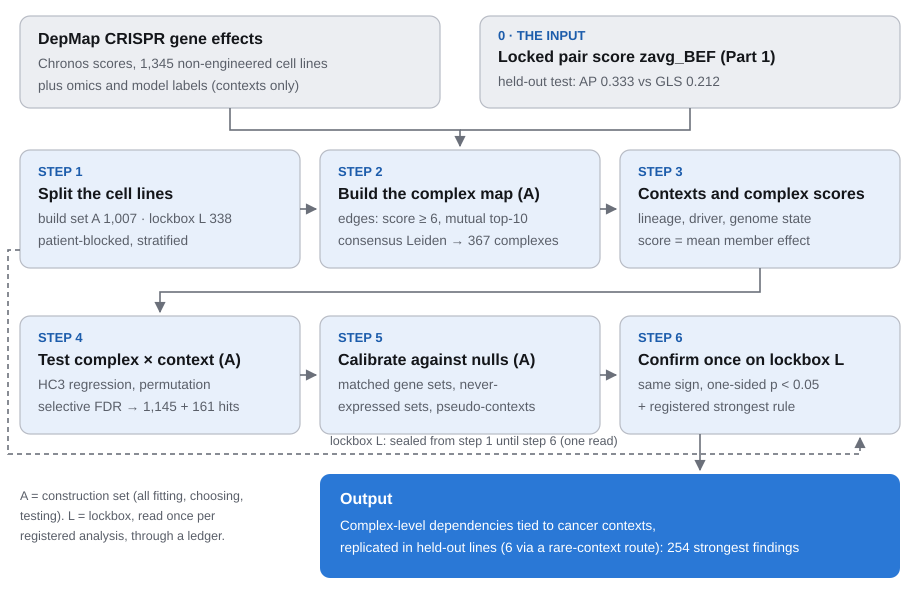
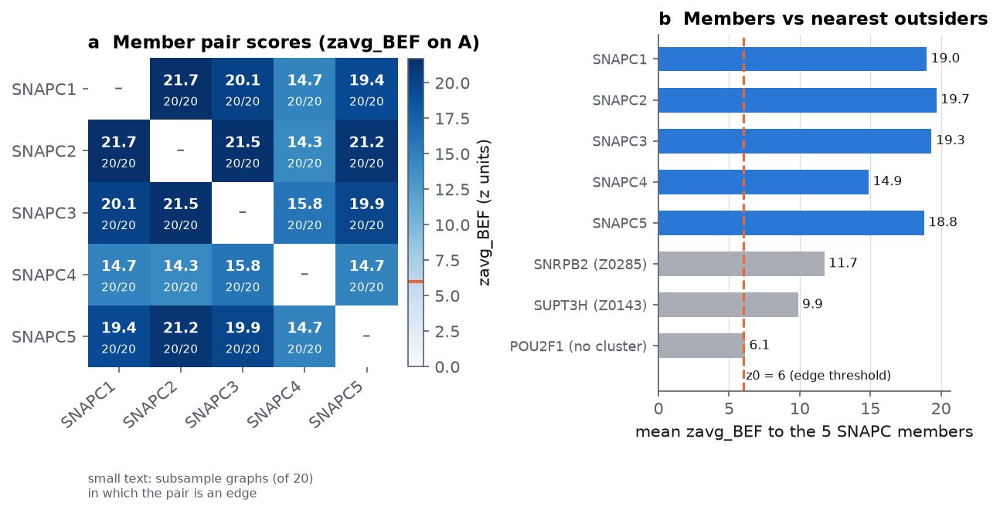
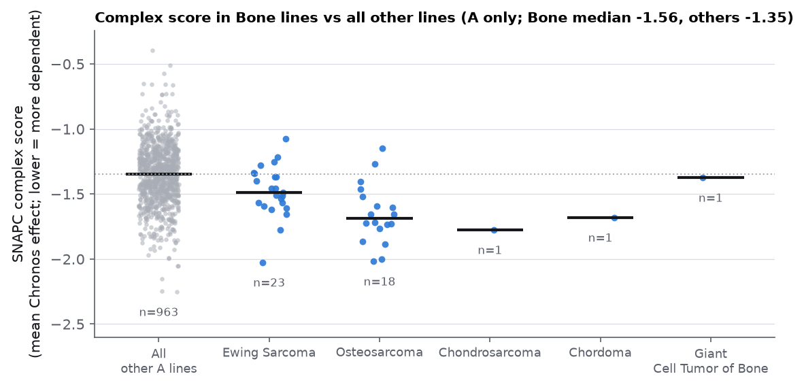
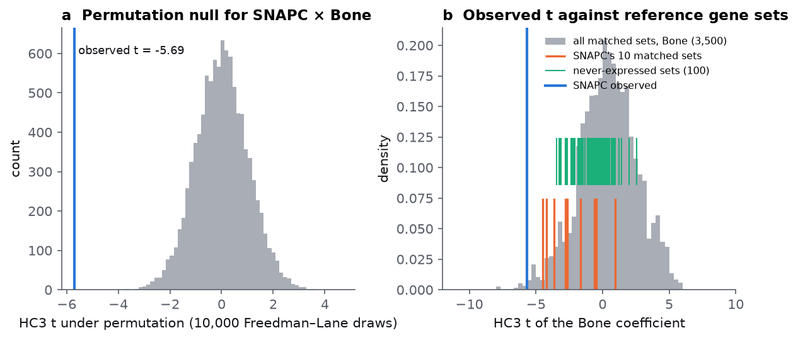
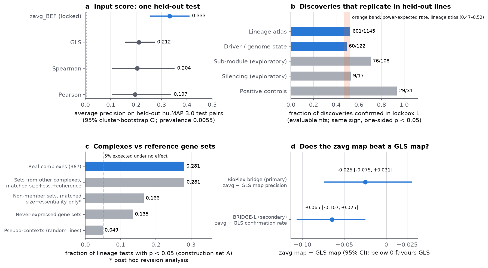

# The method: complex-level cancer dependencies from a locked co-complex score

**In one sentence:** to find protein complexes whose loss hurts some cancers more than others, this method takes DepMap CRISPR knockout data for 1,345 cell lines and a locked score of how likely two genes' proteins share a complex (it runs without labels, but its settings were tuned on hu.MAP training complexes); it builds a map of 367 complexes on three quarters of the lines, tests every complex against omics-defined cancer contexts on those lines, and tests each finding once on 338 held-out lines, ending with 254 registered "strongest findings".

Throughout, a **dependency** is how much a cell line's growth suffers when a gene is knocked out. DepMap reports it as a **Chronos gene effect** (Dempster et al. 2021): 0 means no effect, −1 is the median effect of common essential genes, and more negative means more dependent. A **context** is a yes/no label on a cell line defined from omics or annotation only, such as "Bone lineage", "KRAS hotspot mutation" or "whole-genome doubled".

## How it differs

**Standard approaches.** Three families of published methods address "which complexes matter in which cancers".

- *Per-gene association tests.* Each gene's dependency is regressed on a context (a biomarker screen, as in DepMap's own analyses, Tsherniak et al. 2017). Complexes appear only afterwards, by grouping significant genes. Thousands of genes are tested, each noisy, and the complex-level signal is never tested as a unit.
- *Curated complexes.* Members come from CORUM (Tsitsiridis et al. 2023) or Complex Portal, and a complex score (mean or first principal component of member dependencies) is tested per context. The complexes are fixed by literature, which favours well-studied machinery and can miss what is co-dependent in cancer lines.
- *Co-essentiality modules.* Genes whose dependency profiles co-vary across lines are clustered into modules: Pan et al. 2018 (hierarchical clustering and Louvain within known complexes), Boyle et al. 2018 (Infomap communities scored by their first principal component), Kim et al. 2019 (MCL on a co-essentiality network) and Wainberg et al. 2021 (generalised least squares, GLS, correlations clustered with ClusterONE; lineage tests per gene combined per module with the Cauchy combination test). Clustering thresholds are often tuned on CORUM or GO recovery (Chen 2023 on CORUM; Kim 2019 on GO), which makes the curated resource a construction input.

**What this method does differently.**

1. *Complexes built without curated complexes, from a locked pair score.* Complexes are built from `zavg_BEF`, a pair score that was frozen in a separate project ("Part 1") and tested once on held-out hu.MAP 3.0 complexes. No curated complex, STRING edge or protein-interaction set is used to build the map or choose its parameters; physical evidence (BioPlex 3.0, Huttlin et al. 2021) is read only after the map is frozen. One caveat: the score's configuration was chosen on hu.MAP training labels derived from Complex Portal, so "label-free" applies to the construction, not to the score's history.
2. *Complex-level tests.* The unit of testing is the complex score (the mean member dependency), not each gene.
3. *Pre-registration.* Every analysis is a machine-readable registry entry (`docs/registry/*.yaml`) committed before it runs; the association engine refuses unregistered or edited entries and logs every run in a trial ledger.
4. *A lockbox.* A quarter of the lines (338) are sealed before any dependency value is read and are opened once per registered analysis, through a code path that commits a ledger line first.
5. *Matched-set calibration.* Each complex is compared with random gene sets matched for size, essentiality and coherence, with never-expressed gene sets and with random pseudo-contexts, so the reader can see how often non-complex gene sets "find" the same contexts.

**Why that matters.** Without curated inputs the map can, in principle, find complexes the literature has not catalogued, and its agreement with physical data is not circular. Pre-registration and a one-time lockbox make the false-positive rate and the replication rate measurable rather than tunable: no threshold, covariate or score was adjusted after looking at the held-out lines. Matched sets answer a question the standard approaches skip: is a complex more context-associated than any coherent gene module of the same size and essentiality?

**What it costs.**

- *Power.* A quarter of the lines never contributes to discovery; confirmation in 338 lines is weak for small effects (325 lineage discoveries have |β| < 0.05; REPORT.md §9).
- *Compute.* The map needs 29 recomputations of the pair score (120–175 s each on a laptop) plus split-half selection and consensus clustering: about 2.5 h in all (REPORT.md §4.2).
- *Rigidity.* Errors found after a look cannot be fixed by re-running. A driver defect in the lockbox step had to be handled by labelling 53 calls "no claim" rather than by a clean re-read (REPORT.md §8.2).
- *Honest nulls.* The design reports its failures: the complex map is not better supported by physical data than a GLS map, and complexes are not more context-associated than matched gene modules (see [Results](#results)).

## Overview

<!-- widget:pipeline -->


<a id="step0"></a>
## The input: a locked pair score, and how good it is

**`zavg_BEF` ranks gene pairs by how likely their proteins share a complex, and on held-out complexes it beat the standard co-essentiality score by about 0.12 average precision.** The score is the equal-weight mean of three z-scored similarities between two genes' dependency profiles (a correlation, a neighbourhood cosine and a Laplacian-eigenmap cosine), computed after standardising each gene, removing the top 20 principal components and ridge whitening (REPORT.md §2). It uses no labels when it runs, but its configuration was selected on hu.MAP training complexes. It is imported unchanged from `external/part1_locked` (commit c7f95ee; `src/part2/part1.py::assert_locked`).

The score was evaluated once, under a protocol frozen beforehand (`docs/TEST_PROTOCOL.md`; code `src/testeval/`), on the withheld hu.MAP 3.0 test pairs: 3,312 co-complex pairs among 600,738, a prevalence of 0.55%. The metric is **average precision (AP)**, the mean precision over the ranks at which true pairs are retrieved; a random ranking scores the prevalence (0.0055). Uncertainty comes from a **cluster bootstrap** (B = 2,000) that resamples the 238 test complexes rather than pairs, because pairs from one complex are not independent.

| Method | AP [95% CI] |
|---|---|
| zavg_BEF | **0.333** [0.256, 0.410] |
| GLS (Wainberg et al. 2021) | 0.212 [0.156, 0.273] |
| Spearman | 0.204 [0.106, 0.352] |
| Pearson | 0.197 [0.103, 0.338] |

Source: `results/test_eval/test_results.json` (`results.itt.bootstrap.cluster.stat`). The difference against GLS is +0.121 [+0.079, +0.159]. The gain comes from complexes with many test pairs: weighting each test complex equally ("macro AP"), zavg_BEF scores 0.297 and GLS 0.292, and for complexes with five or fewer positive pairs zavg_BEF is not better (REPORT.md §3.3). Part 2 therefore inherits a score that is clearly better for large complexes and no better for small ones.

**Shaped by:** [Turning point 1](JOURNEY.md#tp1) (frozen, rehearsed single look).

<a id="step1"></a>
## Step 1. Split the cell lines into a construction set and a lockbox

**What it does.** Before any dependency value is read, the 1,345 non-engineered DepMap lines (U) are split into a **construction set A of 1,007 lines**, used for everything that is fitted, chosen or tested, and a **lockbox L of 338 lines**, sealed until the confirmation step. All lines from one patient go to the same side (PatientID-blocked; 0 patients straddle). The split is stratified on labels only: one label per lineage plus 18 genotype labels (MSI-high; loss of function of ARID1A, SMARCA4, STAG2, SMARCB1, PTEN, RB1, KMT2D, CREBBP, EP300; NRF2-active; KMT2A rearrangement; 9p21/MTAP deletion; VPS4B loss; KRAS, NRAS, BRAF, PIK3CA hotspots), so each rare genotype keeps at least 5 L lines where its total allows.

**Why it is needed.** Every later step involves choices: clustering parameters, which of 8,441 tests to call discoveries. Lines that informed those choices cannot also judge them. A lockbox gives one honest replication per finding.

**What goes wrong without it.** With all lines used for discovery, the only check is internal (permutation, FDR), and those assume the model is right. A skeptic's question "would this replicate in lines you had not seen?" would have no answer. Splitting without patient blocking would put sister lines of one tumour on both sides and inflate replication; splitting without stratification could leave a rare genotype with no L lines.

**Code.** `src/part2/lockbox.py::iterative_stratification` (iterative stratification, Sechidis et al. 2011, applied to patient blocks), `label_matrix`, `target_L`; script `scripts/33_make_lockbox.py`; frozen files `results/part2/lockbox/{A_models.txt, lockbox_models.txt, manifest.json}`.
**Parameters.** frac_L = 0.25, seed 3000, minimum 5 L lines per genotype label when 17 ≤ n_U < 20 (so A keeps the 12 needed for a confirmatory test). Runtime 0.6 s.

**Shaped by:** [Turning point 2](JOURNEY.md#tp2) (the lockbox and registry replaced split-half replication).

<a id="step2"></a>
## Step 2. Build the complex map from the pair scores

**What it does.** On A only, the pair score is recomputed and turned into a graph, the graph is clustered many times, and the clusters that recur become the map: **367 complexes covering 3,642 genes**, plus 132 sub-modules.

1. *Gene set.* S = the 6,022 genes with effect < −0.5 in ≥ 1% of A lines, observed in ≥ 95% of A lines, and not flagged low-coverage in Part 1 (`genefilter.py::dependency_bearing_for_models`). Genes that never matter for growth carry no co-dependency signal.
2. *Scores.* zavg_BEF is recomputed with the locked configuration on A, on 20 PatientID-blocked 80% subsamples of A (seeds 1000–1019) and on 8 split halves, each run with its own null moments (`scores.py::zavg_block`, `runsets.py`).
3. *Graph.* Two genes are joined if their score is ≥ z0 **and** each is in the other's top k partners within S (mutual top-k). Edge weight = min(score, z0 + 3) − z0 + 1, so very high scores (often paralogs) cannot dominate (`graph.py::build_graph`, `mutual_knn`).
4. *Consensus clustering.* Each subsample graph is clustered with **Leiden** (Traag et al. 2019) using the constant Potts model (CPM; Traag et al. 2011), which has no resolution limit, at 11 resolutions γ = 0.05·√2^j (j = 0…10), with 5 seeds: 100 runs per γ. The fraction of runs in which two genes share a cluster is a co-clustering frequency (consensus clustering, Monti et al. 2003; Lancichinetti & Fortunato 2012); Leiden-CPM at γ₂ = 0.5 on those frequencies gives each level's clusters (`consensus.py::stage1`, `coclustering`, `stage2`).
5. *Persistence.* A cluster is kept if it recurs (best-match Jaccard ≥ 0.75 at the next γ) over ≥ 3 adjacent γ values, each with support ≥ 0.6, where support is the fraction of the 100 runs that put ≥ 75% of its members in one cluster; the idea of keeping only structure that persists across resolutions is from HiDeF (Zheng et al. 2021). Clusters are placed most-persistent-first; clusters nested inside them become sub-modules (pre-freeze decisions D1 and D2, `results/part2/construction/DECISIONS.md`). Complexes must have 3–60 members and mean within-pair score ≥ z0 on A (sub-modules ≥ z0 + 1) (`consensus.py::persistent`, `build_map`; `construct.py::build_map`).
6. *Parameter choice without labels.* (z0, k) ∈ {4, 5, 6} × {10, 20} is chosen by **split-half recovery**: build maps on two halves of A and count how many selective genes lie in clusters (size 5–30) that reappear in the other half (Jaccard ≥ 0.5), over 4 splits (`selection.py::recovered_coverage`, `select_z0k`). Result: **z0 = 6, k = 10** (0.343; 0.341 at z0 = 4 and 0.338 at z0 = 5, so z0 is weakly determined).
7. *Locus flag.* A cluster is a "locus cluster" if ≥ 50% of its members lie within 10 Mb or on one chromosome arm (`locus.py::locus_flag`). Copy-number changes make neighbouring genes co-vary in CRISPR screens (cutting toxicity), so such clusters are tested but excluded from biological claims: 28.3% of complexes.
8. *Attachment.* Genes outside S (for example a rarely needed subunit) are attached to a complex when ≥ 50% of its members score ≥ z0 to them and a hypergeometric test passes BH q < 0.01 (`attach.py::attach`). Attached genes can define loss events but never enter scores.

After the map was committed, BioPlex and CCLE proteomics assigned **tiers**: T1 = more within-complex BioPlex interactions than a degree- and essentiality-matched null (159 complexes), T2 = protein co-abundance support (74), T3 = tested but not supported or not testable (`validation.py`).

**Why it is needed.** Complex-level tests need complexes. Building them from the locked score, not from CORUM, keeps physical-interaction data free for validation and avoids importing literature bias.

**What goes wrong without it.** A plain threshold on scores produces hairballs: hub genes and paralogs chain unrelated complexes together, which mutual top-k and capped weights prevent. A single clustering run on all lines gives clusters that depend on one random seed and one set of lines; consensus over subsamples and persistence over resolutions keep only structure that recurs (median best-match Jaccard 0.69 across 20 subsample maps against 0.06 for random sets, `results/part2/construction/README.md`). Tuning z0 on CORUM recovery would make any later "the map agrees with known complexes" circular.

**Parameters.** z0 = 6, k = 10, weight cap 3, γ grid 0.05·√2^j (11 values), γ₂ = 0.5, Leiden seeds 0–4, 20 subsamples at 80%, recurrence Jaccard 0.75, support 0.6 (containment-based), ≥ 3 adjacent γ, size 3–60, cohesion ≥ z0 (sub-modules z0 + 1), locus window 10 Mb, attachment BH q < 0.01. Frozen map: `results/part2/construction/zavg_map/` (commit 27fa9b2). Runtime about 2.5 h, dominated by the 29 score runs.

**Shaped by:** [Turning point 3](JOURNEY.md#tp3) (graph and parameters chosen without labels); [Turning point 4](JOURNEY.md#tp4) (the bridges tested whether the map is better than a GLS map).

<a id="step3"></a>
## Step 3. Define contexts from omics, and score each complex in each line

**What it does.** Contexts are 0/1 labels built from DepMap Omics, Model.csv and Ensembl coordinates, never from dependency data (`contexts.py::build`, frozen with family counts in `fzx.py`). They include lineage one-vs-rest (22 lineages with ≥ 12 A lines, plus melanoma at any site), driver hotspots (KRAS, NRAS, BRAF, PIK3CA), functional loss of function (biallelic damaging mutation, or one damaging mutation plus copy loss, or homozygous deletion), MSI-high (MSIScore > 20), whole-genome doubling, TP53 status, copy-number segments (9p21 loss, MYC and MYCN amplification), registered fusions, sex and loss of Y. Contexts with ≥ 12 A lines are confirmatory.

Each complex then gets one number per line, the **complex score**: the mean of its members' Chronos effects, each clipped to [−3, 3], with the line set to missing if fewer than half the members are measured (`cscore.py::mean_score`, `unit_scores`). For a given context, some members are removed first (`cscore.py::removal_for_context`): the context gene itself, its paralogs inside the complex (Ensembl 116), and members within 10 Mb of a copy-number context gene. Lineage contexts remove nothing.

**Why it is needed.** The hypothesis is about the complex as a unit, so the outcome must be one number per line per complex. The mean stays on the Chronos scale, so a coefficient of −0.2 means "0.2 Chronos units more dependent", which a biologist can read. The removals stop trivial findings: a KRAS-mutant context is obviously associated with KRAS's own dependency, and a deleted gene shows no knockout effect simply because it is absent.

**What goes wrong without it.** Defining contexts from dependency data would make every test circular. Without removals, copy-number contexts would "discover" every complex that contains a gene near the amplicon. Without clipping, one line with a broken screen (effects below −3) could drive a mean.

**Parameters.** Clip ±3; 50% observed rule; ≥ 2 members left after removals; paralogs = Ensembl 116 within-species paralogs with ≥ 20% identity; CN window 10 Mb. Contexts frozen at FZ-X (`results/part2/fzx/FZX_manifest.json`); context table built in 86.5 s.

**Shaped by:** [Turning point 8](JOURNEY.md#tp8) (peer review exposed the lineage effect-scale problem).

<a id="step4"></a>
## Step 4. Test complex × context associations on A

**What it does.** For every registered pair (context, complex) with ≥ 12 context and ≥ 12 reference A lines, the complex score is regressed on the context plus covariates by ordinary least squares: always CRISPR library (multi-hot), 3D screen type and model type; lineage for non-lineage contexts; mutation burden and MSIScore for mutation contexts; ploidy, WGD and TP53 status for copy-number contexts. A covariate that is a function of the context is dropped (no lineage covariate for a lineage context) (`covariates.py::covariates_for`, `assoc.py::_design`). Then:

- The coefficient β is tested with **HC3 standard errors** (MacKinnon & White 1985), which stay valid when the residual variance differs between groups, and **Satterthwaite degrees of freedom** (Satterthwaite 1946; Bell & McCaffrey 2002), which are close to the number of context lines rather than to n when a small group drives the variance (`stats.py::HC3Design`).
- **False discovery rate (FDR)**, the expected share of false findings among those called, is controlled by **Benjamini–Bogomolov** selective inference (Benjamini & Bogomolov 2014): each context is a family; families are selected by Benjamini–Hochberg on their Simes p-values (Simes 1986); within each of the R selected families out of M, Benjamini–Hochberg runs at level q·R/M, with q = 0.05 (`stats.py::benjamini_bogomolov`).
- Tests with adjusted q < 0.1 are re-tested by **permutation**: shuffling which lines carry which outcome to see how often chance alone gives a statistic this large. The scheme is **Freedman–Lane** (Freedman & Lane 1983): the covariate-only model's residuals are permuted, so covariate effects are kept. Whole PatientID blocks are exchanged, within lineage for non-lineage contexts and across lineages for lineage contexts (Winkler et al. 2014). With 10,000 permutations, a statistic beyond every permuted one gets a tail estimate from a generalised Pareto fit (Knijnenburg et al. 2009). Permutation p-values replace analytic ones and Benjamini–Bogomolov is re-run (`stats.py::freedman_lane`, `perm_pvalue`; `assoc.py::permutation_p`).

Every call goes through `assoc.py::run_association`, which refuses an analysis whose registry entry (`registry.py`, `docs/registry/*.yaml`) is missing, modified or closed, refuses inputs not in a committed freeze manifest and any line outside A, and appends a count-only line to `results/part2/trials.jsonl`.

**Why it is needed.** Contexts are unbalanced (44 Bone lines against 963 others) and dependency variance differs by lineage, the setting in which ordinary standard errors are too small. Thousands of tests need multiplicity control, and contexts differ hugely in how many complexes they touch, so a per-context family structure fits. Permutation guards against the parametric approximation in the extreme tail where the hits live.

**What goes wrong without it.** Plain OLS errors would understate uncertainty for small contexts; pooled Benjamini–Hochberg would let broad contexts (Lymphoid, 197 discoveries) spend the error budget of narrow ones; without blocking, lines from one patient would be treated as independent; without the registry gate, an analyst could try covariates until something passed.

**Parameters.** q = 0.05; permutation screen q < 0.1; 10,000 permutations; seed 4000 + row index (lineage), 4100 + row index (driver); GPD tail only below p = 10⁻⁴; min 12/12 lines. Scale: lineage atlas 8,441 tests → **1,145 discoveries** in 21 of 23 families; driver/genome-state family 7,340 tests → **161** (`results/part2/directions/*/summary.json`). Simulations of the FDR machinery gave a Benjamini–Bogomolov error rate of 0.046 (`results/part2/verify/h3a_fdr_diagnosis.md`).

**Shaped by:** [Turning point 2](JOURNEY.md#tp2) (pre-registration and the gated engine); [Turning point 5](JOURNEY.md#tp5) (FDR code tested against the guarantee it actually gives); [Turning point 6](JOURNEY.md#tp6) (the covariate defect found after the lockbox read).

<a id="step5"></a>
## Step 5. Calibrate against matched random sets, never-expressed sets and pseudo-contexts

**What it does.** Three reference sets are put through the same score and regression, on A (`calib.py`, `robust.py::pseudo_context_calibration`; script `scripts/46_run_calibrations.py`):

- **Pseudo-contexts**: 100 random relabellings of A lines matching a real context's size (and lineage mix for non-lineage contexts). They measure the test's false-positive rate when the context means nothing.
- **Matched random gene sets**: 10 per complex, drawn from other complexes' members, matched on size, mean clipped effect (±0.1) and mean pairwise zavg_BEF on A (±1.0) (`calib.py::matched_random_sets`). They ask whether a real complex is more context-associated than a coherent gene module of the same size and essentiality.
- **Never-expressed sets**: 100 sets of genes with log1p TPM < 1 in every A line, no two within 10 Mb (`calib.py::never_expressed_pool`, `dispersed_sets`). Knocking out an unexpressed gene should do nothing, so any context association here measures a shift of the CRISPR effect scale in that context.

**Why it is needed.** The FDR in step 4 says "these associations are unlikely to be zero". It does not say they are about complexes. If any five essential genes show the same lineage difference, the finding is about essentiality or screen behaviour in that lineage, not about the complex.

**What goes wrong without it.** A lineage whose screens run "hotter" makes every essential gene look more needed. Without matched sets and never-expressed sets, that artefact would be reported as hundreds of lineage-specific complex dependencies.

**Parameters.** 100 pseudo-contexts per direction (seed 4600 lineage, 4700 driver); R = 10 matched sets per complex, seed `default_rng([4600, unit index])`, tolerances doubled once if fewer than 10 sets pass; 100 never-expressed sets, seed `default_rng([4600, 1000000])`. Pre-declared response: if pseudo-contexts gave p < 0.05 in more than 7.5% of tests, all real tests with p < 0.01 would be permutation-tested (it did not fire: 4.9%). Note: these calibrations were registered but coded only after the discovery runs (PI ruling R4); they changed no discovery. Runtime 35.7 s (lineage directions).

**Shaped by:** [Turning point 5](JOURNEY.md#tp5) (calibrations run late showed matched sets associate as often); [Turning point 8](JOURNEY.md#tp8) (the selection-aware reference and never-expressed sets).

<a id="step6"></a>
## Step 6. Confirm once on the lockbox, and apply the strongest-findings rule

**What it does.** For each registered analysis, a target list (discovered hits and the genes needed) is committed, then `assoc.py::read_lockbox` commits a ledger line and only then loads the L outcome rows, once (`confirm.py::write_target_list`, `confirm_entry`, `lockbox_test`). Each discovery is refitted in L with the same score, removals and covariates. It is **confirmed** if β_L has the same sign and the one-sided p < 0.05 (exact PatientID-blocked permutation when L has fewer than 20 context lines), for contexts with ≥ 5 context and ≥ 5 reference L lines. Rarer contexts take a labelled "rare-context route" (leave-one-lineage-out, DEMETER2 RNAi on A lines and leave-one-line-out all agreeing in sign), which is not an independent replication.

A finding is then one of the **strongest findings** if, by the rule registered in DESIGN §2.5 (`strongest.py::apply_rule`): discovery q < 0.05; confirmed in L (or rare route passed); not affected by the lockbox driver defect; not a locus cluster; and **leave-one-out robust**: refitting on A without each primary disease (lineage contexts) or each lineage (other contexts), every fold keeps the sign with p < 0.05 (`robust.py::loso`). Findings are ranked by tier, then |t| in A.

**Why it is needed.** Discovery statistics in A are inflated by selection (the winner's curse). An independent sample, analysed with a fixed rule, gives an unbiased replication check, and the leave-one-out rule removes findings carried by one disease subtype.

**What goes wrong without it.** Without a single read, one could re-read L after changing the model; without the ledger nobody could tell. Without leave-one-out, a "Bowel" finding could just be a colorectal-adenocarcinoma finding (60 of 64 Bowel lines).

**Parameters.** One-sided α = 0.05 in L; ≥ 5/5 L lines; L permutation seed 6100 + hit index (lineage directions); leave-one-out unit = OncotreePrimaryDisease (lineage directions) or lineage (driver directions and within-complex losses). The single read of all 30 entries took 2.6 h. The per-hit robustness checks were registered but computed after the read, on A only.

**Shaped by:** [Turning point 1](JOURNEY.md#tp1) (frozen, rehearsed single look); [Turning point 2](JOURNEY.md#tp2) (lockbox design); [Turning point 4](JOURNEY.md#tp4) (the held-out-line bridge); [Turning point 6](JOURNEY.md#tp6) (single read and the covariate defect); [Turning point 7](JOURNEY.md#tp7) (the strongest-findings rule); [Turning point 8](JOURNEY.md#tp8) (narrower claims after peer review).

## Worked example: SNAPC1–5 in bone cancers

<!-- worked:start -->
The example is complex **Z0303 = SNAPC1, SNAPC2, SNAPC3, SNAPC4, SNAPC5** and context **Bone lineage** (one-vs-rest). It was chosen from the 37 post hoc lead examples (`results/part2/revision/r2_leads_corrected.tsv`) because it is the smallest of the three candidates (5 genes, against 6 for the APC/AXIN1 unit and 12 for the AP2 unit), its members are exactly the five subunits of a single known machine, the snRNA-activating protein complex (SNAPc), which drives transcription of the snRNA genes U1, U2 and U6, and it is lockbox-confirmed and DEMETER2-supported. The Lung APC/AXIN1 unit carries two genes of unclear function (ANKRD49, FKBPL) and the Myeloid AP2 unit mixes the AP2 adaptor with transferrin receptor and iron transport genes. The SNAPc name is a post hoc reading of the gene symbols; nothing in the pipeline used it.

Every number below was recomputed by `docs/explainer/worked_example.py` on A (14–22 s on a laptop, 3.7 GB peak memory) or copied from a committed result file; outputs are in `docs/explainer/data/worked_example.json`. No lockbox dependency value was read.

#### 0. The input

The five members are among the strongest pairs in the whole score matrix: their 10 pairwise zavg_BEF values on A range from 14.3 to 21.7 z-units (threshold 6). At the test-set level the score's AP was 0.333 against 0.212 for GLS. Whether any SNAPC pair was among the hu.MAP test pairs was not checked here: the test files are not opened outside the single look.

#### 1. Split

U = 1,345 lines → A 1,007 (971 patients) and L 338 (331 patients), none shared. Bone has 59 lines in U: **44 in A** (23 Ewing sarcoma, 18 osteosarcoma, 1 each chondrosarcoma, chordoma, giant cell tumour) and **15 in L** (8 osteosarcoma, 5 Ewing sarcoma, 1 chordoma, 1 other), exactly the 25% target. Bone was a stratification label, so this balance is by design.

#### 2. Complex map



- **All 10 member pairs are edges.** Each pair scores ≥ 14.3 and is mutual top-4 within S on A; each pair is an edge in **20 of 20** subsample graphs. The first four partners of every member are the other four members.
- **Consensus.** In the cached Leiden runs the five genes are in one cluster in **100% of the 100 runs at every one of the 11 resolutions**. The frozen complex persists from γ = 0.1 to 1.6 (9 adjacent values, support 1.0) and its cohesion (mean pairwise score) is 18.33, against a required 6. Across 20 maps each built from one 80% subsample, its median best-match Jaccard is 0.71 (random 5-gene sets: 95th percentile 0.14).
- **Locus.** Members sit on 14q23, 19p13, 9p22, 9q34 and 15q22: at most 1 of 5 per arm or 10-Mb window, so it is **not a locus cluster**.
- **All five members are pan-essential** (effect < −0.5 in 96–99.8% of A lines; mean clipped effect −0.95 to −1.81).
- **Near misses.** SNRPB2 (snRNP biogenesis) scores ≥ 6 with all five members and is a mutual-top-10 edge to three of them, but its own strongest partners are TGS1, SNUPN and GEMIN4; it co-clusters with SNAPC in 54% of runs at γ = 0.1 and was placed in the SMN/Gemin complex Z0285. SUPT3H (SAGA) scores ≥ 6 with all five (mean 9.9) but is never in their top 10, so it forms no edge; it sits in Z0143. POU2F1 (Oct-1, a known SNAPc partner at snRNA promoters) has SNAPC1 as its single best partner and two edges to members, but co-clusters in only 20% of runs and ends in no complex. One gene outside S, INTU, is *attached* (4 of 5 members score ≥ 6 to it; q = 2.7 × 10⁻¹⁰); attached genes never enter the score.
- **Tier (after freeze).** T1: 7 of 10 member pairs are BioPlex interactions, against 0.016 expected under the null (q = 2.9 × 10⁻⁴).

#### 3. Context and complex score

The context is OncotreeLineage = Bone (44 lines) against all other A lines (963); a lineage context removes no member, so all 5 members are scored. The score is the mean clipped effect of the five genes; no line is missing.

| Line | Lineage / disease | Score | SNAPC1 | SNAPC2 | SNAPC3 | SNAPC4 | SNAPC5 |
|---|---|---|---|---|---|---|---|
| ES8 | Bone / Ewing sarcoma | −2.03 | −2.94 | −1.83 | −1.73 | −1.62 | −2.00 |
| NCCOS1X2C1 | Bone / osteosarcoma | −2.02 | −2.63 | −2.03 | −1.77 | −1.21 | −2.46 |
| HUO3N1 | Bone / osteosarcoma | −2.00 | −2.50 | −1.52 | −2.39 | −1.37 | −2.23 |
| 143B | Bone / osteosarcoma | −1.15 | −1.51 | −1.17 | −1.24 | −0.71 | −1.14 |
| NCCES1C1 | Bone / Ewing sarcoma | −1.08 | −1.60 | −0.58 | −1.16 | −0.99 | −1.05 |
| SUM1315MO2 | Breast (median non-Bone) | −1.35 | −1.77 | −1.43 | −1.08 | −0.88 | −1.59 |
| TB096 | CNS (most dependent non-Bone) | −2.25 | −2.32 | −2.60 | −2.56 | −1.13 | −2.65 |
| RERFGC1B | Stomach (least dependent) | −0.40 | −0.76 | −0.03 | −0.06 | −0.49 | −0.64 |



Bone lines: mean −1.56 (SD 0.23); other lines: mean −1.36 (SD 0.23); raw difference −0.20. The shift is a modest move of the whole Bone distribution, not a few outliers, and it holds in both main diseases (Ewing mean −1.48, n = 23; osteosarcoma −1.65, n = 18). Even the least dependent Bone line depends on SNAPC; the finding is about degree.

#### 4. Association on A

Design: intercept, Bone indicator, 5 library indicators, 3D screen type, model type (organoid); lineage was dropped by the covariate rule; n = 1,007.

| | β | HC3 SE | t | df | p (analytic) | 95% CI |
|---|---|---|---|---|---|---|
| Refit (this script) | −0.2104 | 0.0370 | −5.692 | 48.8 | 7.0 × 10⁻⁷ | −0.285, −0.136 |
| Committed (`directions/H3a_lineage_atlas/tests.tsv.gz`) | −0.2104 | 0.0370 | −5.692 | 48.8 | 7.0 × 10⁻⁷ | −0.285, −0.136 |

The refit **reproduces the committed numbers** to all stored digits. The df is 48.8, not about 1,000: HC3 variance is dominated by the 44 Bone lines, and Satterthwaite reflects that.

- **Permutation.** Re-running the engine's Freedman–Lane test with its seed (4000 + row 1036) gives the committed p_perm = 1.41 × 10⁻⁶ exactly. None of the 10,000 permuted |t| reached 5.69 (largest 4.66), so the empirical bound is 1/10,001 ≈ 10⁻⁴ and the reported value is the generalised Pareto tail estimate. That tail estimate is an extrapolation; the conservative statement is p < 10⁻⁴.
- **FDR.** Bone is one of 21 selected families of 23 (family Simes p 5.2 × 10⁻⁷); within it Benjamini–Hochberg runs at 0.05 × 21/23 = 0.0457. Recomputing Benjamini–Bogomolov from the committed p-values gives **q = 9.45 × 10⁻⁵**, as committed; SNAPC ranks 6th of the 69 Bone discoveries.



#### 5. Calibration

- **Matched sets.** Regenerating SNAPC's 10 matched sets with the registered rule and seed reproduces the committed sets and their t-values exactly. They are other 5-gene complex fragments of similar essentiality and coherence: ATR/HUS1/RAD9A/RAD17/WEE1, proteasome assembly chaperones, Mediator, V-ATPase, eIF3, HAUS/augmin. Their t-values range from −4.49 (HAUS) to +0.95; SNAPC's −5.69 is beyond all ten (rank 1 of 11).
- **But Bone is a "broad" context.** Across all complexes, 34.1% of real complexes and 34.0% of matched sets reach p < 0.05 for Bone. Never-expressed sets reach p < 0.05 in **19%** of Bone tests (expected 5%), so Bone screens show a general shift of the effect scale. Pseudo-contexts of Bone's size gave 4.3%, so the test itself is calibrated; the excess is biological or technical signal shared by many gene sets.
- **Reading.** "Beats all 10 matched sets" is weaker than it sounds: in a post hoc analysis, random gene sets put through the same discovery selection beat their own 10 comparators 33% of the time (REPORT.md §7.2). The flag is supportive, not decisive.

#### 6. Lockbox and post hoc checks

From committed files only (`results/part2/lockbox_confirm/H3a_lineage_atlas/confirmation.tsv`, `results/part2/robustness/`, `results/part2/revision/`):

- **Lockbox L (15 Bone lines against 323):** β_L = **−0.251** [95% CI −0.370, −0.132], HC3 p = 1.9 × 10⁻⁴, permutation p = 2.0 × 10⁻⁴ (one-sided, used because L has < 20 Bone lines): **confirmed**. The primary and defect-corrected calls agree, so it is not defect-sensitive. The L effect is slightly larger than in A.
- **Robustness (A):** leaving out each of 82 primary diseases, all 82 folds keep the sign with p < 0.05; leaving out the 2 most dependent Bone lines gives β −0.188 (p 2.2 × 10⁻⁶). Four of five members are individually associated (one-sided p < 0.05: SNAPC1, SNAPC2, SNAPC3, SNAPC5; SNAPC4 β −0.04, p 0.19). The re-run on A reproduces all committed robustness values.
- **Strongest findings:** yes, rank 53 of 254 (T1, ranked by tier then |t|; rank 100 by |t| alone).
- **Complex vs best gene in L (BENCH, committed):** the complex's L t-statistic exceeded that of its best A member, SNAPC5, by 1.29.
- **Scale-artefact check (post hoc):** across all complexes, Bone's β follows complex essentiality with a fitted β of −0.022 at SNAPC's essentiality (−1.36); SNAPC's β lies 3.70 residual SDs beyond that trend, in the trend's own direction. It is therefore a "lead", but the rule cannot exclude that part of the effect is the Bone scale shift amplified for a strongly essential complex.
- **DEMETER2 RNAi (A lines, post hoc):** β = −0.095, one-sided p = 0.0089 (11 Bone lines of 328): same sign, independent perturbation, same lines' biology.

**What this example shows and does not show.** Shown: a five-subunit complex recovered from dependency data alone, with every edge stable; a Bone-wide increase in its dependency that is reproduced by the code, survives permutation, FDR, leave-one-disease-out, a held-out lockbox and RNAi. Not shown: that SNAPc itself, rather than a Bone-wide sensitivity of highly essential transcription machinery, is the operative unit; any mechanism (for example a higher snRNA demand in sarcomas, which is a hypothesis only); or replication outside DepMap.
<!-- worked:end -->

## Pseudocode and code map

```text
# Part 2. Code in src/part2/ (scripts in []). Everything is fitted on A; L is read once per registered entry.
INPUT  E = CRISPRGeneEffect (lines x genes, Chronos);  zavg_BEF = locked Part 1 scorer (part1.py)
# Step 1  lockbox.iterative_stratification                                         [33_make_lockbox.py]
U = DepMap lines − engineered/drug-adapted                                           # 1,345
L, A = blocked_stratified_split(U, labels = lineage + 18 genotypes, blocks = PatientID, frac 0.25, seed 3000)
# Step 2  genefilter, scores, graph, consensus, selection, construct, locus, attach    [31, 34, 36, 37]
S = {g : E[A,g] < −0.5 in ≥1% of A, observed in ≥95%, not low-coverage}              # 6,022 genes
for run in [A] + 20 PatientID-blocked 80% subsamples + 8 half-splits of A:
    Z[run] = zavg_BEF recomputed on run's lines, S x S block
(z0, k) = argmax over {4,5,6}x{10,20} of split-half recovery of selective genes     # → (6, 10)
for b in subsamples: G_b = edges(Z_b ≥ z0 and mutual top-k), w = min(Z,z0+3) − z0 + 1
for γ in 0.05·√2^j, j = 0..10:
    F_γ = co-clustering frequency over Leiden-CPM(G_b, γ, seed s), 20 graphs x 5 seeds
    clusters_γ = Leiden-CPM(F_γ, 0.5)
complexes = clusters recurring (Jaccard ≥ .75; support ≥ .6 = share of runs holding ≥75% of members together)
            over ≥3 adjacent γ, size 3–60,
            mean pair score on A ≥ z0 (sub-modules ≥ z0+1); placed most-persistent-first   # 367
flag locus clusters (≥50% within 10 Mb or one arm); attach non-S genes (hypergeometric, BH < .01)
# Step 3  contexts.build, fzx, cscore.removal_for_context, cscore.unit_scores           [32, 41]
contexts = 0/1 labels from omics + annotation only (lineage, LoF, hotspot, CN segment, fusion, MSI, WGD, ...)
for context c, complex C: M = C − {context gene, its paralogs in C, members ±10 Mb of a CN gene}
    score_C[line] = mean_{g∈M} clip(E[line,g], −3, 3)       (NaN if < 50% of M observed)
# Step 4  covariates.covariates_for, assoc._design, stats.HC3Design, assoc.run_association  [44]
for registered (c, C) with ≥12 context and ≥12 reference lines in A:
    fit score_C ~ 1 + c + library + screen type + model type (+ context-specific covariates)
    t = β / SE_HC3;  p from t(Satterthwaite df)
q = BenjaminiBogomolov(p, family = context, q = .05)
for tests with q < .1: p = FreedmanLane(10,000 perms, PatientID blocks, GPD tail beyond all perms)
discoveries = BenjaminiBogomolov(p, ...) rejections                                  # 1,145 lineage + 161 driver
# Step 5  robust.pseudo_context_calibration, calib.matched_random_sets, calib.dispersed_sets  [46]
per context: 100 pseudo-contexts; 10 matched sets per complex; 100 never-expressed sets → p < .05 rates
# Step 6  confirm.write_target_list, assoc.read_lockbox, confirm.confirm_entry, strongest.apply_rule  [51, 56]
commit target list; ledger line; read L outcomes once
confirmed = same sign and one-sided p_L < .05 (permutation if < 20 context lines in L), ≥5/5 lines in L
strongest = q < .05 ∧ confirmed ∧ ¬defect-sensitive ∧ ¬locus ∧ leave-one-disease/lineage-out robust   # 254
```

| Step | Main code (src/part2/…::function) | Driver script | Frozen output |
|---|---|---|---|
| Input | `part1.py::assert_locked`; `src/testeval/evaluate.py` | `21_evaluate_test.py` | `results/test_eval/test_results.json` |
| 1 | `lockbox.py::iterative_stratification` | `33_make_lockbox.py` | `results/part2/lockbox/` |
| 2 | `genefilter.py::dependency_bearing_for_models`, `scores.py::zavg_block`, `graph.py::build_graph`, `consensus.py::build_map`, `selection.py::select_z0k`, `construct.py::build_map`, `locus.py::locus_flag`, `attach.py::attach` | `31`, `34`, `36`, `37` | `results/part2/construction/zavg_map/` |
| 3 | `contexts.py::build`, `fzx.py::evaluability`, `cscore.py::unit_scores` | `32`, `41` | `results/part2/fzx/`, `results/part2/contexts/` |
| 4 | `covariates.py::per_context`, `assoc.py::run_association`, `stats.py::HC3Design`, `stats.py::freedman_lane`, `stats.py::benjamini_bogomolov`, `registry.py::load_entry` | `44_run_direction.py` | `results/part2/directions/` |
| 5 | `robust.py::pseudo_context_calibration`, `calib.py::matched_random_sets`, `calib.py::dispersed_sets` | `46_run_calibrations.py` | `results/part2/directions/*/calibration*.json` |
| 6 | `confirm.py::confirm_entry`, `assoc.py::read_lockbox`, `robust.py::loso`, `strongest.py::apply_rule` | `51_lockbox_confirm.py`, `56_strongest_findings.py` | `results/part2/lockbox_confirm/`, `results/part2/robustness/` |

<a id="credits"></a>
## Ideas taken from the literature

The method assembles published ideas; what is new is their combination under pre-registration and a one-time lockbox, not any single statistical tool.

| Idea | Source | Where it is used |
|---|---|---|
| Co-essentiality as evidence of shared function; GLS correction for correlated cell lines (the baseline) | Wainberg et al. 2021, *Nat Genet*; Boyle et al. 2018; Pan et al. 2018 | Input score, bridges |
| Gene effects from CRISPR screens (Chronos) | Dempster et al. 2021, *Genome Biol*; Meyers et al. 2017 (copy-number correction) | All steps |
| Held-out complexes for evaluation | hu.MAP 3.0, Fischer et al. 2025, *Mol Syst Biol* | Input test |
| Leiden community detection | Traag, Waltman & van Eck 2019, *Sci Rep* | Step 2 |
| Consensus over repeated clustering runs | Monti et al. 2003; Lancichinetti & Fortunato 2012 | Step 2 |
| Iterative stratification of multi-label data | Sechidis et al. 2011 | Step 1 |
| Heteroscedasticity-consistent (HC3) standard errors | MacKinnon & White 1985 | Step 4 |
| Satterthwaite degrees of freedom | Satterthwaite 1946 | Step 4 |
| Permutation with nuisance covariates; blocked exchangeability | Freedman & Lane 1983 (cited via Winkler et al. 2014) | Step 4 |
| Selective FDR over families of tests | Benjamini & Bogomolov 2014, *JRSS B* | Step 4 |
| Physical-interaction validation | BioPlex 3.0, Huttlin et al. 2021, *Cell* | Bridge, tiers |
| Orthogonal knock-down data | DEMETER2, McFarland et al. 2018, *Nat Commun* | Post hoc check, rare route |
| Protein abundance validation | CCLE proteomics, Nusinow et al. 2020, *Cell* | Tiers, context check |
| Empirical-Bayes power for confirmation rates | Efron 2011 (Tweedie's formula) | Post hoc power aid |

Full references: `LITERATURE.md` and `manuscript/main.md`. Freedman & Lane (1983) itself is not in `LITERATURE.md`; the project cites the method through Winkler et al. (2014).

<a id="results"></a>
## Results and how strong the evidence is

**Main point: the locked score is a better pair ranker, but neither the complex map nor its context findings beat simpler alternatives; what survives is a set of replicated module-level associations.**



| What was evaluated | Against what | Outcome | Evidence strength | Source |
|---|---|---|---|---|
| Pair score on held-out hu.MAP 3.0 test pairs | GLS, Spearman, Pearson | AP 0.333 vs 0.212 / 0.204 / 0.197; ΔAP vs GLS +0.121 [+0.079, +0.159] | Strong for pair-rich complexes (single pre-registered look, independent re-implementation matched to 2.6 × 10⁻¹⁵); none for complexes with ≤ 5 test pairs (macro AP 0.297 vs 0.292) | `results/test_eval/test_results.json` |
| Complex map vs physical evidence (primary bridge) | GLS map with the same genes, k and edge count | Within-complex BioPlex precision 0.157 vs 0.182; Δ −0.025 [−0.075, +0.031] | Null: no difference shown, equivalence not shown either | `results/part2/construction/bridge/bridge.json` |
| Replication of context findings (secondary bridge, BRIDGE-L) | Same machinery on the GLS map | Lockbox confirmation 0.514 vs 0.578; Δ −0.065 [−0.107, −0.025] | Negative (favours GLS); post hoc, power explains 26–41% | `results/part2/lockbox_confirm/bridge_primary_vs_corrected_R7.json`; `results/part2/revision/README.md` |
| Lineage discoveries in L | Power-expected rate 0.47–0.52 | 601 / 1,145 confirmed (0.525) | Replication at the rate power predicts; does not separate biology from reproducible artefacts | `results/part2/lockbox_confirm/rates_primary_R7.tsv` |
| Driver / genome-state discoveries in L | Power-expected 0.43–0.44 | 60 / 122 evaluable (0.492); 0.400 counting 28 failed fits | Moderate; 30 calls defect-sensitive | same |
| Complexes vs matched gene sets | Other complexes' fragments matched on size, essentiality, coherence | p < 0.05 in 28.1% of real vs 28.1% of matched tests (lineage); 12.0% vs 11.6% (driver) | **Parity**: a complex is not more context-associated than a coherent module of the same essentiality; essentiality-only sets 16.6% (post hoc) | `results/part2/directions/H3a_lineage_atlas/calibration_D8.json`; `results/part2/revision/r1a_rates.tsv` |
| Test calibration | Pseudo-contexts | 4.9% (lineage), 4.5% (driver) p < 0.05; 0 FDR rejections | Well calibrated test | `results/part2/directions/*/calibration.json` |
| Effect-scale artefact | Never-expressed sets | 13.5% p < 0.05 (expected 5%), up to 33% in melanoma | A real lineage-scale shift contaminates lineage findings | `calibration_D8.json`; `results/part2/revision/README.md` |
| Registered strongest findings | Rule fixed in DESIGN §2.5 | **254** (207 lineage, 45 driver, 2 within-complex) | Replicated and robustness-checked; rule's checks computed after the read; 26 of 37 post hoc lead examples could still be scale artefacts | `results/part2/robustness/summary.json`; `r2_summary.json` |
| Complex vs its best gene in L (BENCH) | Best member chosen in A | High-breadth tercile Δt +0.240 [−0.033, +0.362] | Inconclusive; 16.5% of bootstrap fits failed silently, so the interval is unreliable (an earlier conclusion against the complex was withdrawn) | `results/part2/lockbox_confirm/BENCH_complex_vs_gene/bench.json`; REPORT.md §4.9 |
| Genetic loss of one subunit (within-complex interactions) | ±0.1 Chronos equivalence margin; matched random member sets | 24 evaluable losses: 11 neutral, 2 residual sensitisation, 1 collapse, 2 paralog compensation; 2 strongest (ARID1A → ARID1B, a registered control; EP300 → CREBBP via the rare route) | Recovers known biology; neutrality rests on the loose ±0.1 margin (0 of 11 within ±0.05) | `results/part2/directions/H1_within_complex_GI/summary.json`; `results/part2/revision/r5_summary.json` |
| Positive controls | Literature dependencies (e.g. WRN in MSI-high) | 15 of 15 evaluable complex-level controls recovered on A; 29 of 31 evaluable confirmed in L | Machinery recovers known biology; thin for lineages (2 controls) | `results/part2/controls/kill_rule.json`; `rates_primary_R7.tsv` |

**What is shown versus believed.** Shown: the pair score's test advantage; that the association machinery is calibrated (pseudo-contexts) and recovers known dependencies; that about half of the discoveries replicate in held-out lines. Believed but not shown: that any specific finding is a property of the complex rather than of an essential, coherent gene module in a lineage with a shifted effect scale. The matched-set parity is the central negative result.

<a id="limitations"></a>
## Limitations, assumptions and when not to use it

**Main point: findings are module-level, DepMap-internal and partly confounded by lineage-wide effect-scale shifts; the lockbox is spent.**

- **Lineage-scale artefacts.** Never-expressed genes "associate" with lineages in 13.5% of tests (19% for Bone, 33% for melanoma). The post hoc trend rule cannot flag effects beyond the trend in its own direction (26 of 37 leads). Statistics were not rescaled.
- **Complex specificity not shown.** Matched coherent modules associate as often as complexes; "beats all matched sets" is largely a selection effect (33% for random sets after the same selection, against 46% for real discoveries).
- **Map choices.** z0 is weakly determined (0.338–0.343 across z0 at k = 10); 28.3% of complexes are locus clusters; some large clusters merge two complexes; about 40% of S genes are in no complex. Small complexes inherit the input score's weakness (no gain over GLS for ≤ 5 test pairs).
- **Single resource.** All dependencies are DepMap CRISPR (Chronos); L shares A's release, processing and Part 1's development data, so lockbox confirmation shows reproducibility within DepMap, not generality. DEMETER2 was used on A lines only.
- **Process deviations.** Calibrations and per-hit robustness were registered but coded after the runs they gate; a lockbox covariate defect affected 560 fits (50 failed, 510 shifted slightly; 3 more failed for genuine reasons), and 53 calls whose primary and corrected readings differ carry no claim; two registry readings were resolved after results were seen (both bounded: 252–254 findings).
- **Not validated.** No experimental follow-up; no external CRISPR collection; no test of whether context changes complex protein abundance; the BENCH question (complex vs best gene) is open; the within-complex "neutral" calls do not hold at a ±0.05 margin.
- **Assumptions.** Linear additive covariate adjustment captures screen batch; Benjamini–Bogomolov's guarantee assumes independence across overlapping contexts, which does not hold; exchangeability of PatientID blocks under the null.
- **When not to use it.** Do not read a single finding as "complex X is a target in cancer Y" without a non-CRISPR, non-DepMap check. Do not use it to rank small complexes (3–4 members) by co-complex confidence. Do not reuse L: it has been read, so any new confirmatory claim needs new held-out data.
